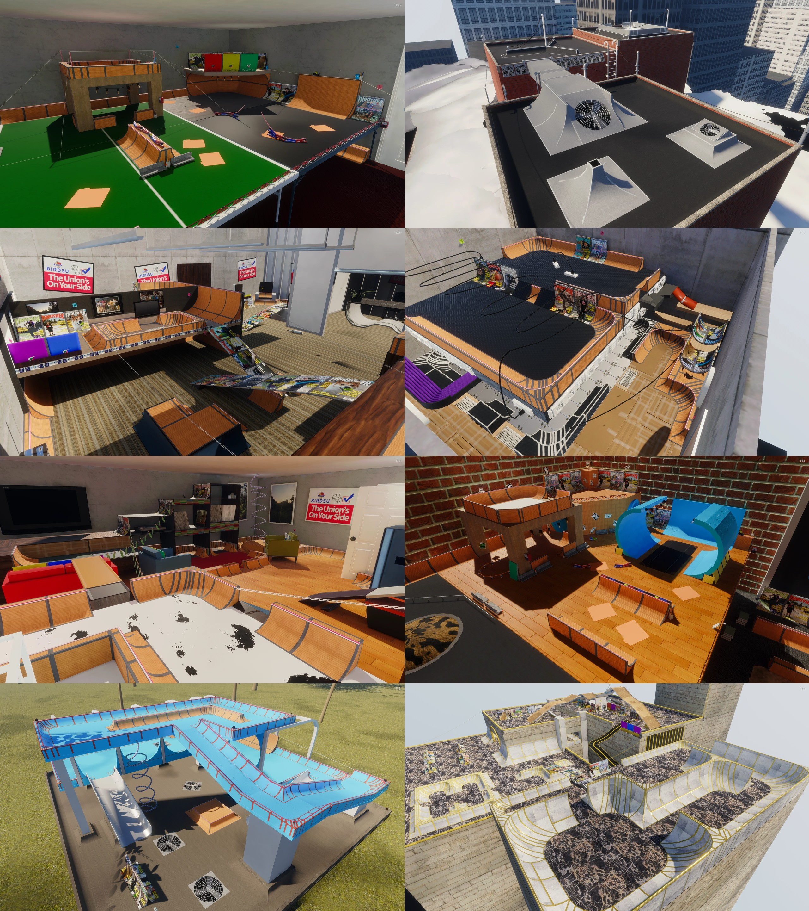

# SkateBIRD for skate.

[](https://github.com/Kalmarv/skatebird-skate/actions/workflows/ci.yml)

A converter that turns the eight skateable levels of SkateBIRD into maps for skate. that load with the ReSkate mod loader. It reads the levels from an installed copy of the game with the [primase](https://github.com/Kalmarv/primase) library, and the finished maps are published as packages on Thunderstore.



## Features

- Converts Bedroom 1, Rooftop, Office, Server Room, Bedroom 2, Flashback, Playground and Skate Heaven, each into its own map
- Reads the levels from SkateBIRD's own Unity 2019.4 player data in the Steam install
- Compiles each map into an installable mod with ReSkate Studio's `reskate_cli`
- Packages each level as a Thunderstore zip with a manifest, README, changelog and an optional 256 px icon
- Places the spawn and five fast-travel points at the game's own reset positions
- Keeps grind rails only on ropes, cables, chains and ziplines
- Leaves out mission collectibles, mission birds, unlocks and the player's own board
- Lights indoor levels with skate.'s sun and sky by making the room shells cast no shadow
- Draws the large windows clear and other glass frosted
- Builds a textured overhead pause map for each level
- Includes a BepInEx plugin and a runner that take SkateBIRD screenshots at exact camera poses, with a fly mode for moving around by hand
- Generates skate. console commands for the same views and side-by-side comparison sheets
- Builds levels in separate processes, three at a time by default, with one log per level; a failed level does not stop the others

## Getting Started

### Requirements

- Windows, with your own copies of SkateBIRD (Steam) and skate. with ReSkate. Nothing from either game is in this repository.
- Rust 1.99 or newer (the minimum of the pinned primase crates).
- A Unity type tree package (`.tpk`) that covers Unity 2019.4.20f1, such as AssetRipper's.
- ReSkate Studio's `reskate_cli.exe`, to compile maps into mods.
- For the reference screenshots only: Git Bash, the .NET SDK (the plugin targets .NET Framework 4.7.2) and an internet connection for the first BepInEx 5.4.23.5 download.

### Installation

To play the levels, install them from the ReSkate launcher's MODS page or from [Thunderstore](https://thunderstore.io/c/reskate/), where each level is its own package (`little_don2/SkateBIRD_Rooftop` and so on).

To build them, clone the repository. It is one Cargo workspace with two packages:

| Package | What it does |
|---|---|
| `skatebird-export` (`program/`) | The conversion: reads each level, writes its ReSkate map and compiles it with ReSkate Studio |
| `skatebird-tools` (`tools/skatebird-tools/`) | Release packaging, skate. view commands, comparison sheets and the SkateBIRD screenshot runner |

Neither package is published to crates.io. Each [release](https://github.com/Kalmarv/skatebird-skate/releases/latest) has both binaries for Windows and Linux (x86_64), each archive with its `.sha256`; or build them from the checkout with `cargo`. primase and its format crates are pinned by git revision in the workspace `Cargo.toml`.

### Usage

Convert every level and compile each one into a mod, then package the results as release zips:

```sh
cargo run --release -p skatebird-export -- \
    --typetrees typetrees.tpk --out build \
    --studio "C:/ReSkateStudio/reskate_cli.exe" --game "C:/Games/skate"
cargo run --release -p skatebird-tools -- package --out build --dest releases --version 0.3.1
```

Each level goes to `build/<level>/`: the map in `map/SkateBIRD_<Name>`, Studio's output in `stage/Patch` and the run's output in `build.log`. `package` writes `releases/SkateBIRD_<Name>-<version>.zip` for each level. The game data is read from the default Steam path unless `--game-data <SkateBIRD_Data>` is given.

Other options and commands:

- `skatebird-export ... level2 level12` converts only the named levels (`level1`-`level5`, `level7`, `level12`, `level13`).
- Without `--studio`, `skatebird-export` writes only the maps. `--game` defaults to `$RESKATE_GAME`, `--oodle` to the game's `oo2core_9_win64.dll`, and `--jobs N` sets how many levels build at once.
- `skatebird-tools package ... --icons <folder>` uses `<folder>/<level>.png` as each mod's icon.
- `skatebird-tools views skate-commands <level>` prints the `RESKATE_STARTUP_COMMANDS` for a level's comparison views (`data/skatebird-views.json`).
- `skatebird-tools sheets --refs <shots> --run <run> --out <folder>` writes side-by-side sheets of SkateBIRD and skate. shots.
- `tools/skatebird_lab.sh` makes a lab copy of SkateBIRD with BepInEx and the plugin; `tools/skatebird_views.sh <level>[,<level>...] <outdir> [--chase]` then takes the reference shots through `skatebird-tools skatebird-shots`. In the lab copy, F6 or a controller's left stick press toggles fly mode.

The scripts find the lab copy through `SKATEBIRD_LAB` (or `skatebird/lab` under `MODDING_CACHE`) and the tooling through `SKATEBIRD_TOOLS` (default: the checkout's `target/release`); `tools/ingame_levels.sh` also reads `RESKATE_TOOLS`, `BUILD` and `RUNS`. `docs/screenshot-runbook.md` describes the screenshot workflow, and `docs/KNOWLEDGE.md` collects the facts about the game data the conversion relies on.

Run the tests with `cargo test --workspace`. The repository has no license file. SkateBIRD is by Glass Bottom Games; this is an unofficial fan port. [CONTRIBUTING.md](CONTRIBUTING.md) describes how releases are made.
