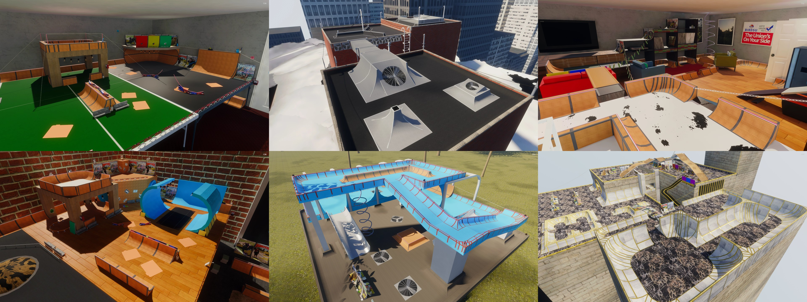

# SkateBIRD for skate.

SkateBIRD's eight skateable levels as maps for skate., through ReSkate, converted from the game's own files with
[primase](https://github.com/kalmarv/primase). An unofficial fan port: SkateBIRD is by Glass Bottom Games.



Bedroom 1, Rooftop, Office, Server Room, Bedroom 2, Flashback, Playground and Skate Heaven, each its own package
(`SkateBIRD_<Level>`) on Thunderstore. Install them from the ReSkate launcher's MODS page.

## How it's made

`program/src/recipe.rs` is the whole conversion of a level: primase reads the level from the game, lowers it to
plain geometry, materials, lights and collision, prepares it for skate. and writes a ReSkate map, which ReSkate
Studio compiles into a mod. What differs by level is in `program/src/choices.rs`.

```
cargo run --release -p skatebird-export -- --typetrees <SkateBIRD type trees .tpk> --out build \
    --studio <ReSkate Studio reskate_cli.exe> [level2 ...]
cargo run --release -p skatebird-tools -- package --out build --dest releases --version <version>
```

It needs your own copy of SkateBIRD (Steam) and of skate.; nothing from either is in this repository's current files.

- `program/`: the conversion. `tools/skatebird-tools/`: packaging, view commands, reference shots.
- `tools/`: game-run scripts and a BepInEx plugin for SkateBIRD reference shots (also a fly mode: F6 or L3).
- `media/`: the pictures the packages' pages show.
